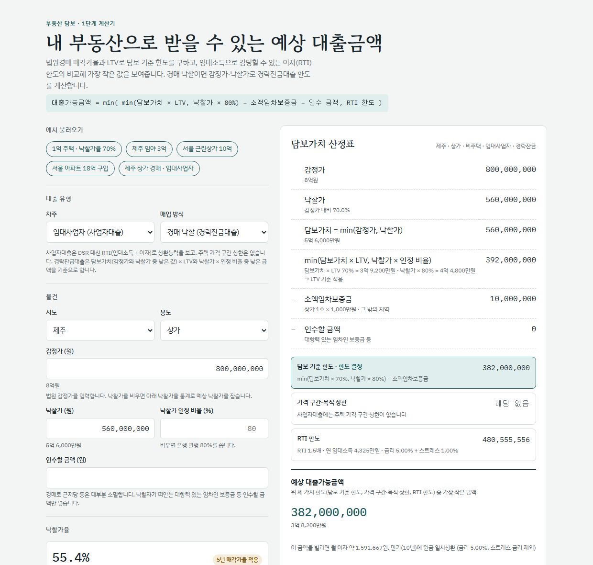
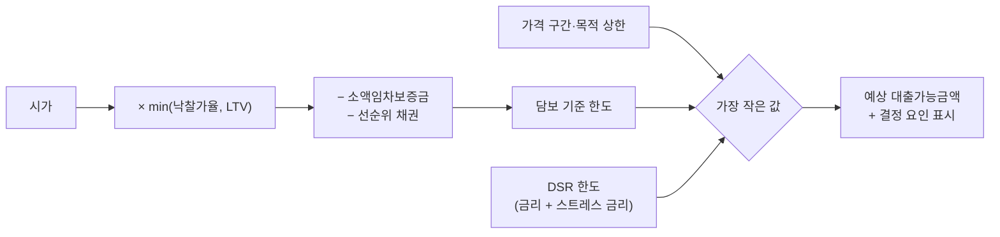

# 담보 대출 한도 확인

부동산을 담보로 개인이 받을 수 있는 대출 한도를 **회수 가능성(경매 낙찰가율)**, **담보 규제(LTV·금액 상한)**, **상환 능력(스트레스 DSR)** 세 기준으로 각각 계산하고, 가장 작은 값과 그 결정 요인을 보여주는 웹 계산기입니다.

> 참고용 추정치이며 실제 금융기관의 심사 결과가 아닙니다. 실제 한도는 금융기관 내부 기준, 감정평가, 신용평가, 최신 금융위원회 규정에 따라 달라집니다.



바로 써 보기: **https://a13443.github.io/cooking/** (휴대폰에서도 열립니다)

로컬 실행: `index.html`을 브라우저로 열면 바로 동작합니다(설치 불필요).

## 만든 이유

담보대출 한도는 "담보가 얼마짜리인가"만으로 정해지지 않습니다. 경매로 넘어갔을 때 실제로 회수되는 금액, 지역·주택 수·목적별 규제, 차주의 상환 능력이 함께 걸리고, 셋 중 하나가 한도를 정합니다. 이 계산기는 세 기준을 한 화면에 나란히 놓고 **어느 기준 때문에 한도가 정해졌는지**, **조건을 바꾸면 한도가 어떻게 달라지는지**를 보이도록 설계했습니다.

## 계산 구조



| 단계 | 내용 |
|---|---|
| 낙찰가율 | 법원경매 매각통계(시도 × 용도)로 산출. max(5년 매각가율, 1년 50% + 3년 30% + 5년 20% 가중평균) |
| LTV | 주택: 규제지역 40%, 비규제 70%, 생애최초·다주택·처분조건부 등 차주 유형별 적용. 비주택(토지·상가·오피스텔): 70%, 비주택 포함 토지거래허가구역 40% |
| 담보 기준 한도 | 시가 × min(낙찰가율, LTV) − 소액임차보증금(호수 × 지역별 최우선변제금, 예상 낙찰가의 1/2 한도) − 선순위 채권최고액 |
| 가격 구간·목적 상한 | 수도권·규제지역 주택구입 시가 15억 이하 6억 / 25억 이하 4억 / 초과 2억, 이주비 6억, 생활안정자금 1억 |
| DSR 한도 | 은행 40%·비은행 50%. 신규 대출은 (대출금리 + 스트레스 금리)로 원리금균등 계산. 비주택 만기일시상환은 원금 ÷ 8년 + 연 이자 |
| 최종 한도 | 위 세 값 중 최솟값. 규정상 대출 불가 조건(규제지역 다주택 주택구입 등)이면 0 |

### 임대사업자(사업자대출)와 경락잔금대출

화면 위 '대출 유형'에서 차주(개인 / 임대사업자)와 매입 방식(매매·보유 담보 / 경매 낙찰)을 고르면 계산 방식이 바뀝니다. 두 가지를 함께 고르면 상가를 낙찰받은 임대사업자의 경락잔금대출 한도가 됩니다.

| 항목 | 임대사업자 (사업자대출) | 경매 낙찰 (경락잔금대출) |
|---|---|---|
| 담보 기준 | 비주택은 비주택담보대출 LTV(70%, 비주택 포함 토지거래허가구역 40%). 주택은 수도권·규제지역 금지(0%), 지방 60% | 담보가치 = min(감정가, 낙찰가). min(담보가치 × LTV, 낙찰가 × 인정 비율(은행 80%·비은행 90%)) − 소액임차보증금 − 인수할 금액(대항력 있는 임차인 보증금 등) |
| 상환 능력 | DSR 대신 RTI = 연 임대소득(월세 × 12 + 보증금 × 간주이자율) ÷ (이번 대출 + 해당 건물 기존 대출의 연 이자). 비주택 1.5배·주택 1.25배 이상. 변동금리는 스트레스 1%p 가산, 고정금리는 미가산. 1억원 이하 대출은 RTI 심사 제외 | 개인이면 DSR, 임대사업자면 RTI |
| 상한 | 주택 가격 구간 상한 없음 | 개인 주택이면 담보가치 기준 가격 구간 상한 |
| 역산 | RTI가 한도를 정하면 담보 기준 한도까지 받는 데 필요한 월세, 고정금리 한도 | 낙찰가를 비우면 감정가 × 낙찰가율 통계로 예상 낙찰가를 잡아 입찰 전에도 계산 |

## 구현 범위

| 포함 | 제외 |
|---|---|
| 개인 차주의 가계대출, 임대사업자(개인사업자)의 부동산임대업 대출(RTI), 경락잔금대출 | 법인 대출, 임대업 외 개인사업자 대출, LTI 심사, 유효담보가액 초과분 분할상환 계획 |
| 주택(아파트·단독·다가구·연립·다세대) 담보 | 업권별(은행·보험·상호금융 등) 내부 기준 차이. 금융권은 DSR 비율(은행 40%/비은행 50%)만 구분 |
| 비주택(토지·상가·오피스텔) 담보 | 감정평가, 신용평가, 소득 증빙 방식 |
| 전국 16개 시도의 낙찰가율·LTV·DSR | 토지거래허가구역 필지 단위 자동 판정(사용자가 체크) |
| 실거래가 자동 채우기: 서울 25개 구, 경기 규제지역 15곳, 제주 (아파트) | 그 밖의 지역·아파트 외 용도의 시세 자동 조회(시세는 직접 입력) |

## 기준으로 삼은 공개 규정과 자료 (기준일: 2026년 10월)

| 항목 | 기준 |
|---|---|
| 수도권·규제지역 주담대 6억 상한 | 2025.6.27 가계부채 관리 방안 |
| 규제지역(서울 전역·경기 12곳), LTV 40%, 가격 구간 상한, 수도권 스트레스 금리 3%, 1주택자 전세대출 이자 DSR 반영, 신용대출 1억 초과 시 주택구입 제한 | 2025.10.15 주택시장 안정화 대책 |
| 규제지역 추가(화성 동탄구·용인 기흥구·구리시) | 2026.7.1 시행 투기과열지구·조정대상지역 추가 지정 |
| 스트레스 DSR(주담대·신용대출·기타대출), 기타대출 스트레스 금리 1.5% | 스트레스 DSR 3단계 (2025.7.1 시행) |
| 차주단위 DSR(가계대출 총액 1억원 초과 시 적용) | 차주단위 DSR 3단계 (2022.7 시행) |
| 비주택담보대출 LTV 70%, 비주택 포함 토지거래허가구역 40% | 은행업감독규정, 금융위원회 10·15 대책 FAQ |
| 만기일시상환 대출 DSR 산정(원금 ÷ 8년) | 금융위원회 '오피스텔 담보대출 DSR 산정방식 개선' 자료의 만기일시상환 기준 |
| 소액임차보증금 최우선변제금 | 주택임대차보호법 시행령·상가건물 임대차보호법 시행령 (2023.2.21 개정 기준) |
| 낙찰가율 | 법원경매정보 용도별 매각통계, 시도별, 2021.10~2026.09 (1년 단위 5개 기간) |
| 임대업 RTI(비주택 1.5배·주택 1.25배, 변동금리 스트레스 최소 1%p, 1억원 이하 제외, 보증금 간주이자) | 금융위원회 개인사업자대출 여신심사 가이드라인 (은행권 2018.3.26, 상호금융 2018.7~2019.1 시행) |
| 수도권·규제지역 주택매매·임대사업자 주담대 금지(LTV 0%) | 2025.9.7 가계부채 관리 강화 방안 |
| 경락잔금대출 min(담보가치 × LTV, 낙찰가 × 80%), 담보가치 = min(감정가, 낙찰가) | 금융기관 관행 (감독규정 아님, 2차 자료) |
| 아파트 실거래가 | 국토교통부 아파트 매매 실거래가 상세 자료, 2025.10~2026.09 (해제 거래 제외, 2026-10-26 수집) |

규제 수치와 규제지역 목록은 모두 `loanRules.js` 한 파일에 모여 있고, 각 값 옆에 근거를 주석으로 적었습니다. 화면은 규정 기준일(`effectiveDate`)에서 6개월이 지나면 확인 경고를 띄웁니다.

## 설계에서 정한 것

- **min(낙찰가율, LTV)**: 규제 LTV가 허용하더라도 경매 회수 가능 금액을 넘지 않도록 두 비율 중 낮은 쪽을 담보 인정 비율로 씁니다.
- **낙찰가율 = max(5년, 가중평균)**: 한 해 값만 쓰면 표본이 적은 지역·용도에서 값이 크게 흔들려서, 5년 누적값과 최근 비중을 높인 가중평균 중 큰 값을 씁니다. 하락 추세가 반영되지 않을 수 있다는 점은 화면에 기간별 내역(1·3·5년)으로 함께 보여줍니다.
- **표본 부족 처리**: 기간별로 지역 매각이 30건 미만이면 같은 지역의 상위 분류 소계, 그것도 부족하면 전국 값을 쓰고, 어느 값을 썼는지 화면에 표시합니다.
- **결정 요인 표시와 역산**: DSR이 한도를 정하면 필요 연소득, 최장 만기, 고정금리, 기존 대출 상환, 비은행 이용 시 한도가 얼마가 되는지 역산해 보여줍니다.
- **규정과 계산 분리**: 규정 수치(`loanRules.js`)와 계산 함수(`loanLimit.js`)를 나눠, 정책이 바뀌면 수치만 고치고 테스트로 확인할 수 있게 했습니다.

## 검증

`npm test`로 계산 테스트 52개를 실행합니다(Node.js 내장 테스트, 추가 설치 불필요). 대표 사례:

| 사례 | 결과 | 결정 요인 |
|---|---|---|
| 규제지역 무주택, 시가 14억 | 5.6억 | LTV 40% |
| 규제지역 무주택, 시가 20억 / 30억 | 4억 / 2억 | 가격 구간 상한 |
| 규제지역 다주택 주택구입 | 대출 불가 | LTV 0% |
| 연소득 5천만, 은행, 금리 4% + 스트레스 3%, 30년 | 약 2.5억 (이 금액에서 DSR 정확히 40%) | DSR |
| 비주택 임야, 만기일시상환 | 원금 ÷ 8년 + 이자로 DSR 산정 | DSR |
| 지방 단독주택 1억, 낙찰가율 70%, 주택 1호 | 1억 × 70% − 2,500만 = 4,500만 | 낙찰가율 |

## 한계

- **수동 갱신**: 규정·규제지역·낙찰가율·실거래가는 자동으로 갱신되지 않습니다. 정책이 바뀌거나 새 통계가 나오면 `loanRules.js`와 데이터 파일을 직접 갱신해야 합니다.
- **업권별 차이 미반영**: 은행·보험·상호금융·저축은행마다 다른 내부 LTV·심사 기준은 반영하지 못합니다.
- **2차 자료 의존**: 일부 규정(혼합형·주기형 스트레스 반영 비율, 정책모기지 요건, 비주택 만기일시상환의 DSR 간주 만기 등)은 원문 대신 보도·금융기관 안내로 확인했습니다. `loanRules.js` 주석에 '확인 필요'로 표시했습니다.
- **토지거래허가구역**: 비주택까지 포함해 지정된 구역인지는 필지 단위로 확인해야 해서 사용자가 직접 체크합니다.
- **시세**: 실거래가 자동 채우기는 서울·경기 규제지역·제주 아파트만 지원하며, 그 밖에는 시세를 직접 입력합니다.

## AI 사용 범위

이 프로젝트는 [Claude Code](https://claude.com/claude-code)(AI 코딩 도구)로 구현했습니다.

- **직접 정한 것**: 계산 구조(낙찰가율과 LTV의 적용 순서, 가중평균 비중, 소액임차보증금 차감 방식), 적용 범위, 화면 구성, 원천 데이터(법원경매 매각통계) 수집
- **AI로 진행한 것**: 코드·테스트 작성, 규정 관련 공개 자료 검색과 정리
- **검증**: 계산 결과는 테스트와 수기 계산으로 대조했고, 규정 수치는 공개 자료와 대조했습니다.

## 파일 구성

| 파일 | 내용 |
|---|---|
| `index.html` | 계산기 화면 |
| `loanRules.js` | 규제 수치·규제지역·최우선변제금 (정책이 바뀌면 이 파일만 수정) |
| `loanLimit.js` | 한도 계산 함수 (LTV, 금액 상한, 스트레스 DSR, 대출 불가·경고 조건, 역산) |
| `tests/loanLimit.test.js` | 계산 테스트 |
| `data/auction_rates.*`, `scripts/build_rates.py` | 시도 × 용도 낙찰가율 표와 생성 스크립트 |
| `data/trades.js`, `scripts/fetch_trades.py` | 아파트 실거래가 표와 수집 스크립트 |

## 데이터 다시 만들기

### 낙찰가율 표

법원경매정보에서 시도별 '용도별 매각통계'를 1년 단위로 내려받아 기간별 폴더에 두고 실행합니다.

```
pip install xlrd
python scripts/build_rates.py <2021.10~2022.09 폴더> <2022.10~2023.09 폴더> <2023.10~2024.09 폴더> <2024.10~2025.09 폴더> <2025.10~2026.09 폴더>
```

### 아파트 실거래가 (선택)

1. 공공데이터포털(data.go.kr)에서 '국토교통부_아파트 매매 실거래가 상세 자료' 활용신청 후 일반 인증키(Decoding) 복사
2. 실행. 지역은 묶음 이름이나 시군구 코드(법정동 코드 앞 5자리)로 지정하고, 주지 않으면 `서울`을 받습니다.

| 묶음 이름 | 지역 |
|---|---|
| `서울` | 서울 25개 구 |
| `경기규제` | 경기 규제지역 15곳 (`loanRules.js`의 규제지역 목록과 같은 이름) |
| `제주` | 제주시, 서귀포시 |

```
python scripts/fetch_trades.py --key <인증키>                      # 서울
python scripts/fetch_trades.py --key <인증키> 경기규제 제주          # 묶음 여러 개
python scripts/fetch_trades.py --key <인증키> 11680 "41135=성남시 분당구"   # 코드 직접 지정
```

인증키는 `--key` 대신 환경변수 `DATA_GO_KR_KEY`로 줘도 됩니다. 기본은 최근 12개월이고 `--months`로 바꿀 수 있습니다. 이미 `data/trades.js`가 있으면 새로 받은 지역만 바꾸고 나머지 지역은 그대로 둡니다. 처음부터 새로 만들려면 `--replace`를 붙입니다.

`코드=이름`으로 직접 붙인 이름이 규제지역 목록의 이름과 같아야(띄어쓰기 포함) 화면에서 실거래가 시·군·구를 고를 때 LTV 계산용 시·군·구가 함께 선택됩니다.

결과는 `data/trades.js`에 저장됩니다(표준 라이브러리만 사용, 해제 거래 제외). 인증키는 파일에 저장되지 않습니다.

## 면책

본 결과는 참고용이며 실제 심사 결과가 아닙니다. 실제 한도는 금융기관 심사 및 최신 금융위원회 규정에 따라 달라질 수 있습니다. (규정 기준일: 2026-10)
